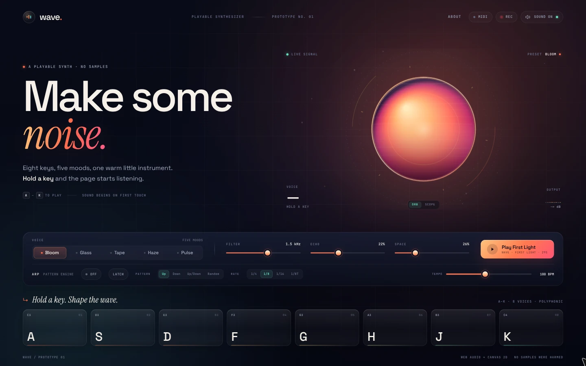

# Wave — the playable synth

**Live demo:** https://jimmerioles.github.io/wave/

A landing page for a browser synthesizer where the hero is the instrument.
Hold a key or tap a pad, and the orb, rings, particles and meters answer the
sound you make. No video, no waveform loop, no samples.

The demo button plays a short, synthesized arrangement of the chorus of
“Goodness of God” — melody and bass, scheduled through the same eight-voice
instrument you play by hand.



Wave is one of five prototype studies in high-craft interactive landing pages:
static-first, one signature interaction, a physical metaphor, sound only on
gesture, and a reduced-motion fallback.

## Run it

```bash
npm install
npm run dev
```

Open the URL Vite prints (usually `http://localhost:5173`).

```bash
npm run build     # type-check + production build
npm run preview   # serve the production build at /wave/
```

## Play it

- **Hold** `A` `S` `D` `F` `G` `H` `J` `K`, or press and hold any pad. The
  pads cover a full C-major scale from C3 to C4.
- **Bloom / Glass / Tape** change the oscillator mix, filter, envelope and
  delay character — and tint the orb to match.
- **Filter** sweeps the shared low-pass cutoff. **Echo** controls how much of
  the ping-pong delay returns.
- **Play the chorus** performs a 34-second arrangement of “Goodness of God”.
  The demo adds two high notes above the keybed for the chorus lift. `Esc`
  stops it early.
- **Sound on** mutes and unmutes. The visualizer keeps reacting while muted.
- **About** opens a short prototype note and the demo credit.

Audio starts only after the first pointer or key gesture. Nothing autoplays.
The master output is intentionally low (0.2) and compressed.

## Easter egg

Triple-tap the wave mark, or enter the Konami code
(`↑` `↑` `↓` `↓` `←` `→` `←` `→` `B` `A`). A 12-second, 118 BPM synth-pop
arrangement of the “Never Gonna Give You Up” chorus plays — bright lead,
syncopated synth bass, drum machine and the B♭–C–Dm–C chord bed — then the
stage returns to the current preset. If sound is off, the gag is visual-only.
`Esc` stops it. The About dialog has a small hint.

## What is implemented

**Sound**
- Eight-voice polyphony with three oscillators per voice (saw, triangle, sine).
- Shared resonant low-pass filter, per-note ADSR envelope, detuned layers.
- Stereo ping-pong delay with damped feedback, soft-clip saturation and a
  master compressor.
- `AnalyserNode` drives every visual response; mute is applied after the
  analyser so the instrument stays alive visually with sound off.
- AudioContext suspends when the page is hidden and resumes on the next
  gesture.

**Visual instrument**
- Canvas 2D orb with a solar core, warped bands and a pointer-following
  highlight.
- Live waveform ring from time-domain audio, plus circular spectrum ticks and
  slow orbit arcs.
- Soft springs on level, bass, treble and pointer parallax.
- Note-on particles and expanding ripples; ambient drifting motes.
- Canvas loop stops when reduced motion is requested or the stage leaves the
  viewport. The reduced-motion scene is a calm static orb with a DOM level
  meter.

**Demo**
- A fixed chorus arrangement of “Goodness of God” in C: 63 BPM, one intro
  bar plus eight chorus bars, melody and bass scheduled into the live synth.
- The keybed exposes eight pads (C3–C4). The demo uses two extra high notes
  (D4/E4) internally for the chorus lift; they have no pads.

**Easter egg**
- A hidden 12-second synth-pop arrangement of the “Never Gonna Give You Up”
  chorus at 118 BPM: bright detuned lead, syncopated synth bass, drum machine
  and a chord pad, all synthesized at runtime.
- Triggered by triple-tapping the brand mark or the Konami code. It stops the
  main demo, restores the stage, respects mute and reduced motion, and stops
  on `Esc`.

**Page**
- Typography: Space Grotesk + Instrument Serif accents + JetBrains Mono.
- Deep navy field, coral sunset hero, mint/cyan signal accents.
- Responsive composition at 1280×800 and 390×844. Mobile pads reflow to a
  4×2 grid; the page fits without scrolling at those target sizes.
- Keyboard-accessible pad buttons with visible focus states, `aria-pressed`,
  a focus-trapped About dialog and native range controls.
- Keyboard notes are suppressed while a control or dialog is focused.
- Pointer events support multi-touch pads, capture, and idle cancellation.

## Structure

```
index.html        static shell, copy, controls
src/style.css     layout, identity, responsive + reduced-motion styles
src/audio.ts      Web Audio graph, presets, voices, note helpers
src/orb.ts        Canvas 2D visualizer and particle system
src/main.ts       pad/keyboard input, preset + slider wiring, demo, lifecycle
CONCEPT.md        original brief
```

There are no runtime dependencies beyond Vite and TypeScript. Fonts come from
Google Fonts; everything visual is CSS, SVG or Canvas, and every sound is
synthesized at runtime.

## Roadmap

Five candidate next passes, roughly in order of leverage:

1. **Arpeggiator + tempo.** A latch/hold arpeggiator with rate control and
   up/down/random patterns would turn the pads into a playable pattern engine
   and give the demo tempo and pattern controls.
2. **Record & share a loop.** Record the master output with `MediaRecorder`,
   preview the take, and download a shareable WebM/WAV clip.
3. **Sound design pass.** Add a reverb, a couple more presets, and persist the
   chosen preset, filter and echo values in `localStorage`.
4. **Visual polish.** An oscilloscope mode, per-preset motion signatures,
   pointer glissando across pads, and further mobile layout refinements.
5. **MIDI input.** Web MIDI detection with note-on/off and velocity mapped into
   the existing engine and keybed.

## Rough edges

- The demo is a fixed chorus arrangement, not a full song player or sequencer.
  There is no tempo control, loop length or timeline editing.
- The keybed is one octave. The demo reaches two notes above it internally, but
  those notes are not playable from the pads.
- The circular spectrum maps lower frequencies to more ticks for looks, not
  scientific accuracy.
- The synth has been built and interaction-tested headlessly; the audio graph
  has not been tuned on every output device.
- The About dialog is the whole "product" story — there is no downstream app,
  pricing or docs page behind the prototype.

## Credits

“Goodness of God” (CCLI #7117726) words and music by Jenn Johnson, Jason
Ingram, Ben Fielding, Ed Cash and Brian Johnson. The demo is a short
synthesized arrangement used for this prototype; all rights belong to the
writers and publishers.

“Never Gonna Give You Up” was performed by Rick Astley and written by Mike
Stock, Matt Aitken and Pete Waterman. The easter egg is a short synthesized
quote used for this prototype; all rights belong to the writers and publishers.
